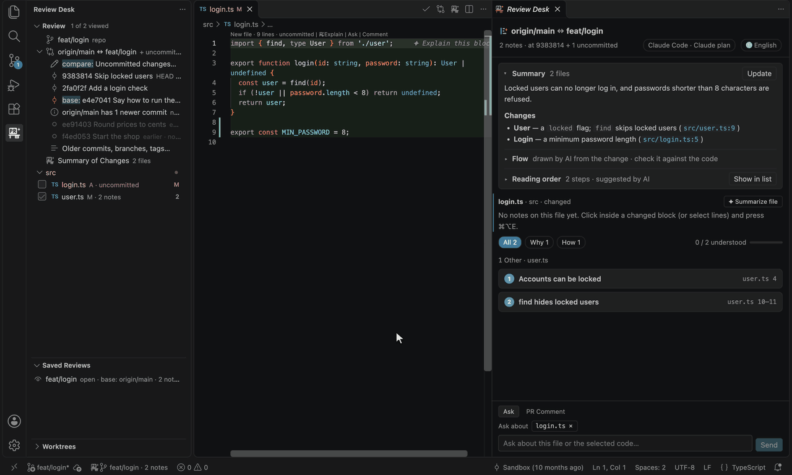
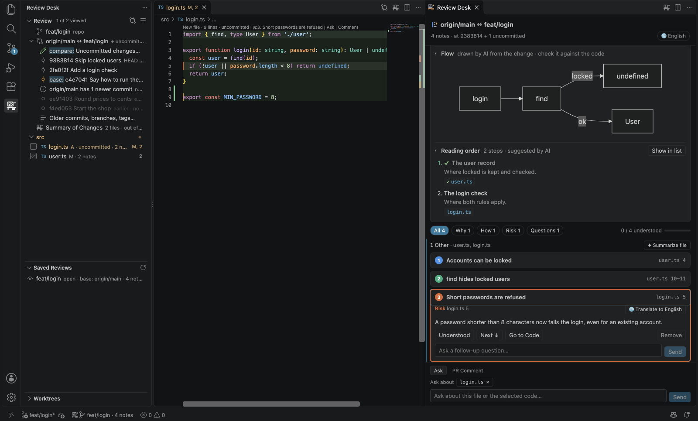

# Review Desk

**Review code changes and pull requests with AI notes beside the code.** Pick the lines you are reading, and Review Desk writes a short note on why they changed, how they work, or what could go wrong. Then ask follow-up questions, draft review comments and post them to the pull request, all without leaving VS Code.

> **Review Desk runs your own Claude Code, or your own Codex (ChatGPT).** It does not call any AI service itself and never asks for, sees, or stores your credentials. Each note or answer is a run of the `claude` or `codex` command you have installed and signed in to, on your machine, under your own subscription (a Claude plan or a ChatGPT plan) or API key. That is the same as if you ran it yourself. Review Desk is an independent project and is not made, endorsed, or supported by Anthropic or OpenAI.

## What it does

- **Review a branch, a range of commits, or a pull request.** The Review list in the sidebar shows what is compared with what (`origin/main ↔ feat/login`), the commits in between, and the changed files with **Viewed** checkboxes. You can change either side, review uncommitted work, or open another branch in a git worktree.
- **Notes on demand, never in bulk.** Select lines, or click **Explain** above a changed block, and a note appears in the notes panel and next to the code (a numbered badge). Its color tells the kind: Why, How, Risk, Context, Question, Overview, PR Comment. Nothing is sent to Claude until you ask.
- **Ask follow-up questions** on a note, or about the selected code, the current file, or the whole change.
- **Summary of the change**: what changed across the files, a suggested reading order, and a diagram of the flow it adds or alters.
- **Pull requests on GitHub** (github.com or your GitHub Enterprise Server):
  - Open a pull request from a list or by its address and review it here.
  - Bring its review threads in, then reply on GitHub or let Claude summarize the discussion or draft a reply.
  - Draft a PR comment on lines ([Conventional Comments](https://conventionalcomments.org) style, with a `suggestion` block when a small fix fits), edit it, and post it.
  - Post your notes as a PR review after editing a preview.
  - New replies and resolved threads are marked. A **Sync** button reads GitHub right away.
- **Notes in any language** (`reviewDesk.language`). Notes written in another language can be translated with one click.
- **Claude Code chat connection** (optional): your Claude Code chat can read the review's notes and save its answers as notes next to the code.

## Requirements

- VS Code 1.101 or later and git.
- **[Claude Code](https://code.claude.com), installed and signed in** (the default). Run `claude` once in a terminal to sign in with your Claude account or an API key. Review Desk finds `claude` on your PATH, in `~/.local/bin` (Claude Code's installer), or the one bundled with the Claude Code extension for VS Code; on Windows, an npm install of Claude Code works too. You can also set `reviewDesk.claudePath` in your user settings.
- **Or [Codex](https://developers.openai.com/codex), installed and signed in**, picked with **Review Desk: Choose Agent…** (or by clicking the agent label at the top of the notes panel). Install it with `npm install -g @openai/codex` or `brew install --cask codex`, then run `codex login` to sign in with your ChatGPT account (or use an API key). Review Desk finds `codex` on your PATH, or set `reviewDesk.codexPath`.
- For pull requests: a GitHub sign-in in VS Code. Review Desk asks when it needs it.

## Getting started

1. Open a git repository and switch to the branch you want to review.
2. Open **Review Desk** in the activity bar and click **Start Review**, or **Open GitHub Pull Request…**.
3. Open a changed file, select some lines and press **Cmd+Alt+E** (macOS) or **Ctrl+Alt+E** (Windows/Linux). You can also click **Explain** above a changed block.
4. Read the note in the notes panel. Ask a follow-up in the box below it.

## Cost

Review Desk runs the agent only when you click or run a command. Every run is billed to your own account: it counts toward your subscription's usage limits (a Claude plan, or a ChatGPT plan for Codex), or is charged to your API key.

- **Asked once, before the first run** of each agent. The first time you ask for a note, Review Desk shows which Claude Code (or Codex) it runs and that its runs use your account. Nothing runs until you choose **Continue**.
- **Always shown.** The top of the notes panel says which agent and account the runs use: `Claude Code · Claude plan`, `Claude Code · API key`, `Codex · ChatGPT plan` or `Codex · API key`. Click it to pick the agent from a list that shows, for each, whether it is installed and signed in, and with which plan (and, for Claude Code, which account).

- With Claude Code, each note, question or reply is capped at **$0.50** (`reviewDesk.maxBudgetUsd`), and a summary of the whole change at **$2** (`reviewDesk.summaryMaxBudgetUsd`). Codex has no such limit to pass.
- `reviewDesk.model` picks a smaller model (for example `sonnet` or `haiku`) for lower cost. When it is empty, Claude Code's default model is used.
- `reviewDesk.codexModel` picks the model for Codex runs.
- `reviewDesk.effort` sets how much the model thinks before writing (`medium` by default; `low` uses less), for both agents. Translations always use `low`.
- Checking GitHub for new replies uses the GitHub API only, with no AI cost.
- Each run is an ordinary non-interactive run (`claude -p`, or `codex exec`). How it is counted against your plan or billed to your API key follows Anthropic's or OpenAI's current rules, which they may change. Review Desk does not change them or work around them.

## Privacy and security

- **What goes to the AI:** the code excerpts and diffs a note needs, sent through your Claude Code to Anthropic (or your Codex to OpenAI) as with any session of it. Claude Code runs with read-only tools (Read, Grep, Glob) and cannot edit files or run commands; Codex runs in its read-only sandbox, where the commands it runs can read but not write, without web search, and without your `~/.codex/config.toml` (so none of its MCP servers; set the model with `reviewDesk.codexModel`).
- **What goes to GitHub:** API calls to github.com, or to the GitHub Enterprise Server you set in `github-enterprise.uri`, and nowhere else. Nothing is posted without your confirmation.
- **No telemetry.** Review Desk sends nothing anywhere else.
- **Stored locally:** notes are kept in your repository's `.git/review-desk/` folder, so they are never committed.
- **Safe with untrusted code:**
  - Claude Code runs with your own settings only, not the reviewed repository's `.claude/settings.json`. Codex reads a repository's `.codex/config.toml` only when you have trusted that project in Codex, and never lets it choose where your credentials go or which commands run.
  - Settings that run a program or spend usage (`agent`, `claudePath`, `codexPath`, the models, the cost limits) are read from your user settings only, never from a repository's.
  - Comments written by others on GitHub are passed to Claude as quoted material, not as instructions.
  - Review Desk does not run in Restricted Mode.

## Settings

| Setting                          | Default               | What it does                                                        |
| -------------------------------- | --------------------- | ------------------------------------------------------------------- |
| `reviewDesk.language`            | `English`             | Language of notes and answers (any language name).                  |
| `reviewDesk.commentLanguage`     | (same)                | Language of drafted PR comments.                                    |
| `reviewDesk.agent`               | `claude`              | `claude` (Claude Code) or `codex` (Codex). User settings only.      |
| `reviewDesk.model`               | (Claude Code default) | Model for Claude Code runs. User settings only.                     |
| `reviewDesk.codexModel`          | (Codex default)       | Model for Codex runs. User settings only.                           |
| `reviewDesk.effort`              | `medium`              | How much Claude thinks (`low` … `max`). User settings only.         |
| `reviewDesk.maxBudgetUsd`        | `0.5`                 | Cost limit per note, question or reply, in USD. User settings only. |
| `reviewDesk.summaryMaxBudgetUsd` | `2`                   | Cost limit for a summary of the whole change. User settings only.   |
| `reviewDesk.claudePath`          | (found)               | Full path of the `claude` executable. User settings only.           |
| `reviewDesk.codexPath`           | (found)               | Full path of the `codex` executable. User settings only.            |
| `reviewDesk.baseRef`             | (PR target)           | Base to compare with when the branch has no PR target.              |
| `reviewDesk.includeUncommitted`  | `true`                | Include uncommitted edits and new files.                            |
| `reviewDesk.githubCheckMinutes`  | `5`                   | How often to look for new replies on GitHub (0: off).               |

All settings are under **Review Desk** in the Settings editor.

## Language

Menus and buttons are in English. Notes, answers, summaries and PR comments can be written in any language.

## License

[MIT](LICENSE). Third-party software included in the extension is listed with its licenses in [ThirdPartyNotices.txt](ThirdPartyNotices.txt).

Claude and Claude Code are trademarks of Anthropic, PBC. OpenAI, ChatGPT and Codex are trademarks of OpenAI. GitHub is a trademark of GitHub, Inc. Review Desk is not affiliated with any of them.

---

The names of every part of the UI are in [docs/ui-names.md](docs/ui-names.md).
