# Review Desk UI names

A name for every part of Review Desk's UI: the panels, the rows of its lists, the buttons and the marks it adds to the editor. Use these names in issues, questions and docs, so everyone means the same part.

Each picture has numbered pins; the table under it has the same numbers. **Call it** is the name to use; **On screen** is the text you see there. Rows without a number are not in the picture.

Screens: November 2026, the build with the ☰ menu (PR #7) and question cards that open at once (PR #8).

## Contents

- [The window](#the-window)
- [Review list (during a review)](#review-list-during-a-review)
- [Review list (before a review)](#review-list-before-a-review)
- [Saved Reviews and Worktrees](#saved-reviews-and-worktrees)
- [Editor](#editor)
- [Notes panel: header and Summary](#notes-panel-header-and-summary)
- [Notes panel: notes and the question box](#notes-panel-notes-and-the-question-box)
- [Question card and badge colors](#question-card-and-badge-colors)
- [The ☰ menu](#the--menu)
- [Lists and dialogs that ask](#lists-and-dialogs-that-ask)
- [Status bar](#status-bar)
- [Commands](#commands)

## The window

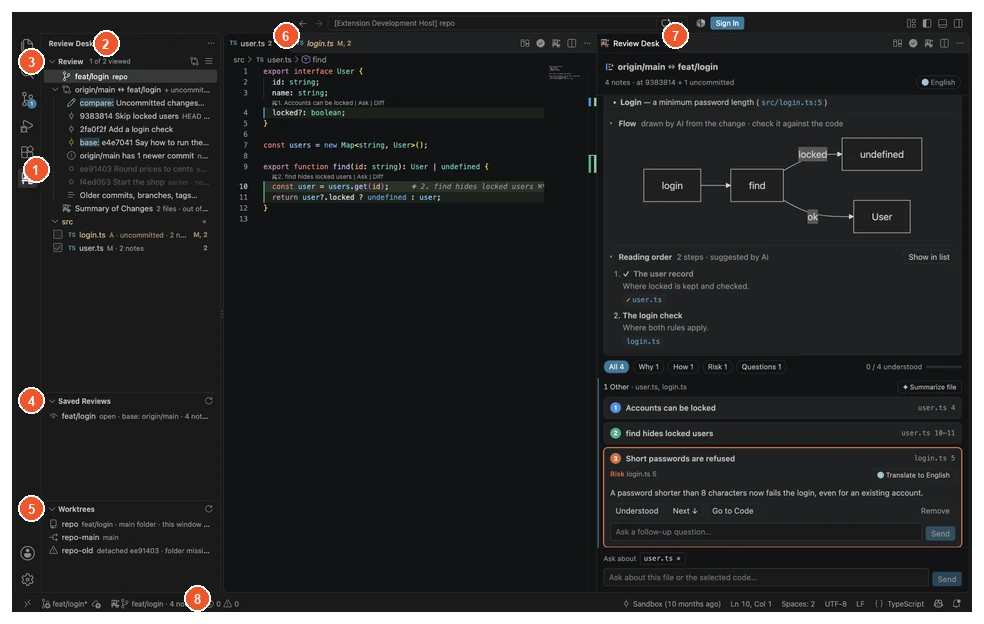

| # | Call it | On screen | What it is |
|---|---|---|---|
| 1 | **Review Desk icon** | `Review Desk` | In the activity bar. Opens the Review Desk side bar. |
| 2 | **Review Desk side bar** | `REVIEW DESK` | The three lists below (3, 4, 5). |
| 3 | **Review list** | `Review` | The comparison under review and its changed files. See [Review list](#review-list-during-a-review). |
| 4 | **Saved Reviews list** | `Saved Reviews` | The review saved for each branch. |
| 5 | **Worktrees list** | `Worktrees` | The git worktrees of the repository. Folded at first. |
| 6 | **Editor** | `user.ts` | VS Code's editor. Review Desk adds links above changed blocks, change marks and title bar buttons. |
| 7 | **Notes panel** | `Review Desk` | The panel opened as an editor tab on the right: the summary, the note cards, the question box. |
| 8 | **Status bar item** | `feat/login · 4 notes` | Review Desk's item in the status bar. Opens the same menu as ☰. |

## Review list (during a review)

The two sides of a comparison are named as on GitHub's compare page: the **base** (the diff's left) and the **compare** side (its right, what is reviewed). Text puts the base first, as VS Code diff titles do: `origin/main ↔ feat/login`. The rows under the **comparison row** draw the comparison as a branch: the compare end at the top, the base end at the bottom.

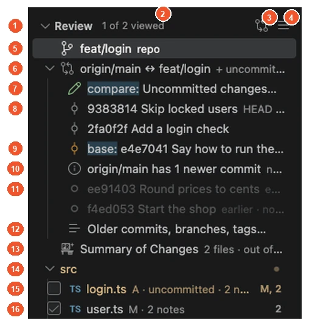

| # | Call it | On screen | What it is |
|---|---|---|---|
| 1 | **Review title bar** | `Review` | The list's name. |
| 2 | **Viewed count** | `1 of 2 viewed` | Changed files ticked Viewed. |
| 3 | **Compare button** | `⇄` | Same as clicking the comparison row: opens the Compare list. |
| 4 | **☰ menu button** | `☰` | Everything else. See [The ☰ menu](#the--menu). |
| 5 | **Branch row** | `feat/login` `repo` | The top row: the branch checked out and its folder. With several folders in the window, click it to review another. Its icon is a branch, or the worktree icon when the folder is a git worktree. How the branch stands against the remote: its icon becomes a yellow ↑ (to push), a blue ↓ (to pull) or an orange ⟳ (both), and turns green in sync; beside the folder, `↑2` (to push), `↓1` (to pull) or `↑3 not pushed`. |
| 6 | **Comparison row** | `origin/main ↔ feat/login` | The base ↔ the compare side. Click: the Compare list (which side to change, or paste a pull request address). |
| 7 | **compare row** | `compare: Uncommitted changes` | The compare end, the side under review. Click: Change Compare Side… (working tree, HEAD, another branch). |
| 8 | **Commit row** | `9383814 Skip locked users` | A commit between the ends. Click: Compare from Here, Compare up to Here, Copy SHA. Hover: ← and → buttons. |
| 9 | **base row** | `base: e4e7041 …` | The base end: where the branch left the base. Click: Change Base…. |
| 10 | **Newer commits row** | `origin/main has 1 newer commit` | The base branch moved on since; those commits are not compared. |
| 11 | **Earlier row** | `ee91403 … earlier · not compared` | Five commits before the base, dimmed. Click one to move the base back to it. |
| 12 | **Older commits row** | `Older commits, branches, tags…` | Opens the full list of bases. |
| 13 | **Summary of Changes row** | `Summary of Changes` `2 files · out of date` | The summary of the change. Click to write it, or to show it in the notes panel. |
| 14 | **Folder row** | `src` | A folder with changed files. |
| 15 | **File row** | `login.ts` `A · uncommitted · 2 notes` | A changed file. The box in front is the **Viewed checkbox**. A/M/D/R: added, modified, deleted, renamed. The number at the end: its notes. |
| 16 | **File row (viewed)** | `user.ts` `M · 2 notes` | A file ticked Viewed. Changed again later, it is unticked and marked `changed since viewed`. |
|  | **More commits row** | `… 52 more commits` | Over 15 commits between the ends: shows 50 more per click. |
|  | **Finish row** | `PR #6 merged into main` `finish review…` | The review's pull request was merged or closed. Click: Finish Review…. |
|  | **Dim marks** | `whitespace only` `moved code` `imports only` `generated` `renamed only` | On files that need no line-by-line reading, with a grey icon. |
|  | **Step rows / note group rows** | `1. The user record` `1. Other` | Instead of folders when the list shows Reading Order or Notes in Order (☰ menu). |

## Review list (before a review)

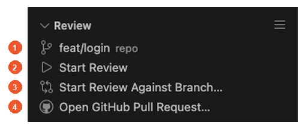

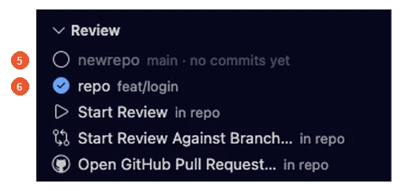

| # | Call it | On screen | What it is |
|---|---|---|---|
| 1 | **Repository row** | `feat/login` `repo` | The branch checked out and its folder. |
| 2 | **Start Review row** | `Start Review` | Reviews this branch against its base (the pull request target, else main). |
| 3 | **Start Review Against Branch row** | `Start Review Against Branch…` | Pick the base first. |
| 4 | **Open GitHub Pull Request row** | `Open GitHub Pull Request…` | Opens the pull request list: pick an open one, or paste the address of any. |
| 5 | **Folder row** | `○ newrepo` `main · no commits yet` | With several repositories, one row each. Click to pick it. Dimmed when it has no commit yet. |
| 6 | **Picked folder row** | `✓ repo` `feat/login` | Where Start Review starts. Its ▷ button (on hover) starts there at once. |

## Saved Reviews and Worktrees

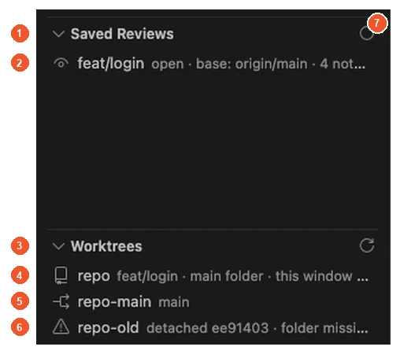

| # | Call it | On screen | What it is |
|---|---|---|---|
| 1 | **Saved Reviews title bar** | `Saved Reviews` | The review saved for each branch. |
| 2 | **Saved review row** | `feat/login` `open · base: origin/main · 4 notes · …` | Branch, `open` when it is the open review, base, notes, last change. Click to reopen it. Hover: the trash button. A review of another worktree says `in <folder>`. |
| 3 | **Worktrees title bar** | `Worktrees` | The git worktrees of the repository. |
| 4 | **Worktree row** | `repo` `feat/login · main folder · this window` | Its icon (a yellow ↑, a blue ↓, an orange ⟳, green in sync) and `↑2`, `↓1` or `↑3 not pushed` beside the branch: how it stands against the remote, as in the branch row. `main folder`: the original folder (repository icon); the others are worktrees made from it (worktree icon). `this window`: the one open here. Also `reviewed · N notes`, `made by Review Desk`. |
| 5 | **Worktree row** | `repo-main` `main` | Click it to review it in this window. Hover: Review in This Window (▷: added to the window and reviewed), Open in New Window (reviewed there), Add to This Window (only added), Remove Worktree (trash), Copy Remove Command. |
| 6 | **Worktree row (missing)** | `repo-old` `detached … · folder missing` | A worktree whose folder was deleted. |
| 7 | **Refresh button** | `⟳` | Reads the list again (it usually follows on its own). |

## Editor

What Review Desk adds to a changed file (here `user.ts`, the cursor on line 10).

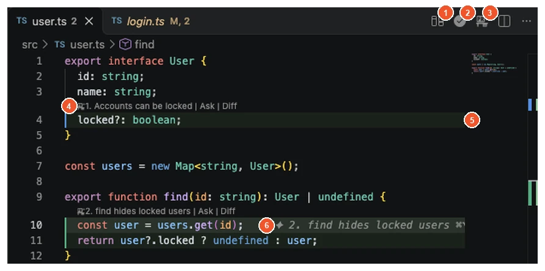

| # | Call it | On screen | What it is |
|---|---|---|---|
| 1 | **Show Diff button** | `Review Desk: Show Diff` | Editor title bar. Turns this tab into the diff in place; the diff has a **Show File** button there to turn it back. |
| 2 | **Viewed button** | `✓ Mark File as Viewed` `● Mark File as Not Viewed` | Editor title bar. Ticks the file Viewed (or not), as the file row's checkbox does. |
| 3 | **Notes panel button** | `Open Notes Panel` | Editor title bar, the Review Desk logo. Opens the notes panel again. |
| 4 | **Block links (CodeLens)** | `Explain · Ask · Comment · Diff` `1. Accounts can be locked | Ask | Comment | Diff` | Small links above each changed block; a note's title in place of Explain when there is one. Comment drafts a PR comment on the block. |
| 5 | **Change marks** |  | Outside a diff too: changed lines in light green with a bar by the line numbers, a dotted line where lines were deleted. |
| 6 | **Line-end hint** | `✦ Explain this block ⌘⌥E` `✦ 2. find hides locked users ⌘⌥E` | With the cursor in a changed block. The shortcut explains the block, or opens its note. |
|  | **Dim block mark** | `⊘ whitespace only` | A block that needs no reading: dim text and the reason above it. |
|  | **Hover menu** | `Explain · Ask · Diff` | On a changed line: the same links and the deleted lines. |
|  | **Inline / Side by Side buttons** | `Show Diff Inline (- +)` `Show Diff Side by Side` | Diff tab title bar: one column or two. |

## Notes panel: header and Summary

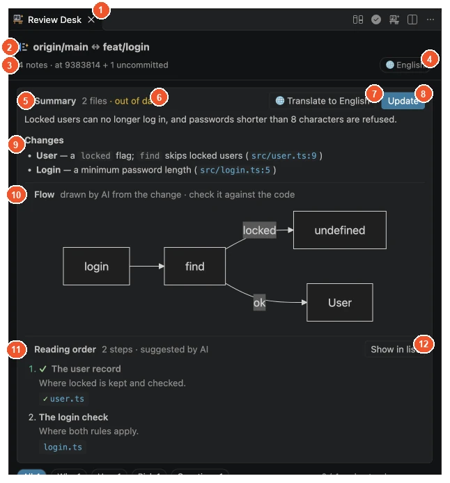

| # | Call it | On screen | What it is |
|---|---|---|---|
| 1 | **Notes panel tab** | `Review Desk` | The notes panel's tab, like an editor tab. |
| 2 | **Panel title** | `origin/main ↔ feat/login` | Base ↔ compare side. A pull request link under it when the review is for one. |
| 3 | **Panel meta line** | `4 notes · at 9383814 + 1 uncommitted` | Notes, commit, uncommitted files; `● writing` while notes are being written. |
| 4 | **Language button** | `🌐 English` | The language Claude writes in. Click: Change Answer Language…. |
|  | **Agent button** | `Claude Code · Claude plan` `Codex · ChatGPT plan` `… · API key` | Before the Language button: the agent Review Desk runs (Claude Code, or Codex with reviewDesk.agent), and whether its runs use a plan's usage limits or an API key (as the agent said; the agent's name alone before its first run). Click: the Agent list. |
|  | **Agent list** | `Agent for notes and answers` `Claude Code` `Codex` `What Review Desk sends, and who pays` | Choose Agent… (the Agent button, the ☰ menu, the palette): each agent with how it stands (not installed, not signed in, Claude Max plan, ChatGPT plan, API key; Claude Code's account), ● on the current one. Picking one not signed in offers Sign In in a Terminal. |
| 5 | **Summary section** | `Summary` `2 files` | The summary of the change; its title row folds it. Without one: the ✦ Summarize changes button. |
| 6 | **Out of date mark** | `out of date` | The change moved on since the summary was written. |
| 7 | **Summary Translate button** | `🌐 Translate to English` | Only when the summary is not in the current language. |
| 8 | **Update button** | `Update` | Writes the summary again for the change as it is (blue when out of date). |
| 9 | **Summary text** | `Changes` | The summary. A path like `src/user.ts:9` opens that line. |
| 10 | **Flow** | `Flow` `drawn by AI …` | The diagram drawn with the summary. |
| 11 | **Reading order** | `Reading order` `2 steps · suggested by AI` | The order to read the change in. ✓ on viewed files, ● on files changed since. |
| 12 | **Show in list button** | `Show in list` | Shows the Review list in that order. |

## Notes panel: notes and the question box

One note is one card. Click its title to unfold it; only an unfolded card shows its text and buttons.

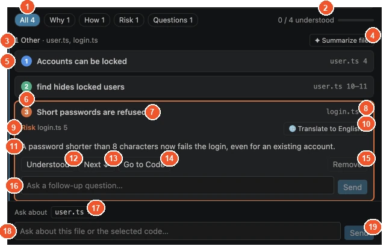

| # | Call it | On screen | What it is |
|---|---|---|---|
| 1 | **Kind filter** | `All 4` `Why 1` `How 1` `Risk 1` `Questions 1` | Shows the notes of one kind. |
| 2 | **Understood progress** | `0 / 4 understood` | Notes marked Understood. |
| 3 | **Note group header** | `1 Other · user.ts, login.ts` | A group of notes and its files; highlighted for the current file's group. |
| 4 | **Summarize file button** | `✦ Summarize file` | Writes a summary note of the current file. |
| 5 | **Folded card** | `1  Accounts can be locked` `user.ts 4` | Badge, title, where. `● answering` in place of where while an answer comes. |
| 6 | **Number badge** | `3` | The note's number; its color is the note's kind (see below). |
| 7 | **Card title** | `Short passwords are refused` | The note's title, also in the block links. |
| 8 | **Card location** | `login.ts 5` | File and line. |
| 9 | **Card meta line** | `Risk login.ts 5` | Kind and place; also `moved`, `outdated`, `from the Claude Code chat`, `View on GitHub`. |
| 10 | **Note Translate button** | `🌐 Translate to English` | Only when the note is not in the current language. |
| 11 | **Card text** |  | The note. |
| 12 | **Understood button** | `Understood` `✓ Understood` | Marks it understood. |
| 13 | **Next button** | `Next ↓` | The next card. |
| 14 | **Go to Code button** | `Go to Code` | Opens its lines in the editor. |
| 15 | **Remove button** | `Remove` | Deletes the note. |
| 16 | **Follow-up box** | `Ask a follow-up question…` `Send` | Asks more on this card. Enter sends, Shift+Enter adds a line. |
| 17 | **Ask target chip** | `Ask about` `user.ts ×` | What the bottom box asks about: the selected code, the current file, or, after ×, the whole change. |
| 18 | **Question box** | `Ask about this file or the selected code…` | At the bottom of the panel. Makes a new question card. |
| 19 | **Send button** | `Send` | Sends the question. |

## Question card and badge colors

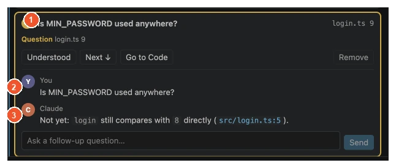

| # | Call it | On screen | What it is |
|---|---|---|---|
| 1 | **Question badge** | `4` | Yellow: a question you asked. |
| 2 | **Your message** | `You` | Yours in the thread; `… selected` when you asked about selected code. |
| 3 | **Claude's answer** | `Claude` | `answering` while it is written. A comment from GitHub shows its author instead. |

**Number badge colors** — the kind of the note:

| Color | Kind | Means | Chosen by |
|---|---|---|---|
| 🔵 blue | Why | why it changed | Claude, when it writes the note |
| 🟢 green | How | how it works | Claude |
| 🟠 orange | Risk | what the reviewer should check | Claude |
| 🟣 purple | Context | background needed to follow it | Claude |
| 🟡 yellow | Question | a question you asked, with its answers | always, for questions |
| ⚪ grey | Overview | a summary of a file | Summarize file |
| 🩷 pink | PR Comment | a review comment for the pull request author, to edit and post | Draft PR Comment |

## The ☰ menu

The ☰ button of the Review list and the status bar item open this menu. Type to find an item. Its sections show on the right in grey.

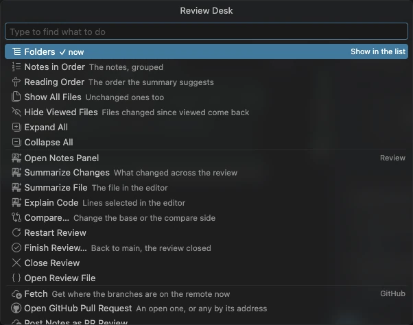

| Section | Items | |
|---|---|---|
| `Start` | Start Review, Start Review Against Branch…, Start Review in Folder… | only with no review open |
| `Show in the list` | Folders, Notes in Order, Reading Order (the current one says ✓ now), Show All Files ↔ Show Changed Files Only, Hide Viewed Files ↔ Show Viewed Files, Expand All, Collapse All | how the Review list shows the review |
| `Review` | Open Notes Panel, Summarize Changes, Summarize File, Explain Code, Draft PR Comment…, Compare…, Restart Review, Finish Review…, Close Review, Open Review File |  |
| `GitHub` | Fetch, Open GitHub Pull Request, Post Notes as PR Review, Re-import GitHub Comments |  |
| `Claude` | Connect / Disconnect Claude Code Chat, Change Answer Language…, Translate Notes into the Current Language |  |
| `Help` | Show Log, Report a Problem… |  |

## Lists and dialogs that ask

They open at the top of the window.

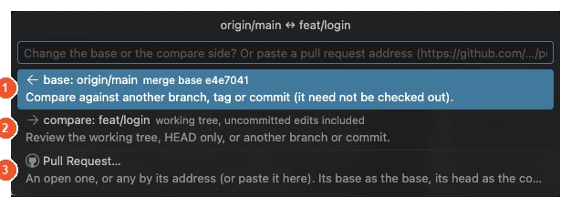

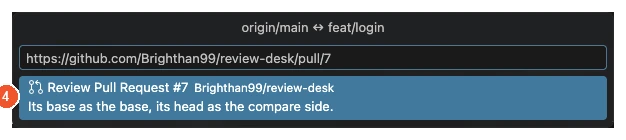

| # | Call it | On screen | What it is |
|---|---|---|---|
| 1 | **base item** | `← base: origin/main` | Change the base: opens the base list. |
| 2 | **compare item** | `→ compare: feat/login` | Change the compare side: opens the compare list. |
| 3 | **Pull request item** | `Pull Request…` | Opens the pull request list: an open one, or any by its address. |
| 4 | **Review Pull Request item** | `Review Pull Request #7` | Appears when a pull request address is pasted into the Compare list. |
|  | **Base list** | `HEAD` `Branches` `Tags` `Recent commits` `📌` | Picks the base. Each branch shows its commit, and each recent commit the branches and tags on it: `9383814 (HEAD, main, origin/main)`. The 📌 beside a branch also remembers it as the pull request target. |
|  | **Compare list** | `Working Tree` `HEAD` `a branch or commit` | Picks the compare side; shows branches and commits as the base list does, and takes a pull request address too. |
|  | **Pull request list** | `Review a Pull Request` `#12 …` `From the clipboard: Pull Request #123` `Sign in to GitHub to List the Open Pull Requests` | The open pull requests of the repository here, and any pull request by its address pasted in. Open GitHub Pull Request, Open Pull Request by Its Address… and the Pull Request… item all open it. |
|  | **Place question** | `Open in a New Window (git worktree)` `Add to This Window as a Folder (git worktree)` `Switch to It in This Window` | Where to check out another branch or a pull request. |
|  | **Language list** | `Language of notes and answers` | Change Answer Language…. |
|  | **Folder list** | `Start Review in Folder` | One of the repositories of the window: a repository icon for a repository's own folder, the worktree icon and `git worktree` for a worktree. |
|  | **Translate dialog** | `Translate the summary and 3 notes …?` `Translate` | After a change of language. |
|  | **Agent notice** | `Review Desk runs your Claude Code` `Review Desk runs your Codex` `Continue` | Asked once per agent, before Review Desk first runs it: which executable, that runs count toward the signed-in account's plan limits or API key. Dismissed: nothing runs. |
|  | **Finish Review dialog** | `Switch and Delete …` `Switch to main` | When finishing a review. |
|  | **Finish Review dialog (worktree)** | `Remove Worktree and Delete …` `Remove Worktree` `Close Review Only` | When finishing a review in a worktree: removes it (its tabs close, it leaves this window, or its window closes), the branch too when merged. |
|  | **Review preview document** | `Post as Comment` `Approve` `Request Changes` `Cancel` | Opened by Post Notes as PR Review; its buttons are at the top. |
|  | **PR Comment box** | `Ask | PR Comment` `Comment on login.ts 5–7` `Draft` | The box below the notes, switched to PR Comment by Draft PR Comment, the Comment link or its tab: say what the comment should say (empty: Claude finds it), then Draft. Its lines are the ones picked, else those selected in the editor. |
|  | **Comments or notes question** | `Post PR Comments Only` `Post Comments and Notes` | Asked by Post Notes as PR Review when PR comments and explaining notes are both unposted. |
|  | **Sync button** | `⟳ Sync` `checked 2 min ago` | Beside the PR link at the top of the notes panel: reads the pull request on GitHub now (its state, every review thread and reply), and says when it last did. |
|  | **GitHub reply buttons** | `Summarize Thread` `Draft Reply` `Reply` `Post Reply` `Discard` | On a card with a GitHub conversation (an imported thread, or replies to a note posted from here). Summarize Thread and Draft Reply ask Claude; Post Reply posts the reply in that thread. `● 1 new` on a card, `● 2 new replies` on the panel: replies not seen yet. |
|  | **Resolved mark** | `✓ Resolved` `resolved on GitHub by octocat` | On a card whose GitHub thread is resolved (an imported thread, or a note or PR comment posted from here): set back in the list, the mark where its place was; who resolved it on its meta line. Gone when the thread is opened again. |
|  | **Hide Resolved button** | `✓ Hide Resolved 2` | Beside the kind filter, when any thread is resolved: hides those cards (the open one stays); again shows them. |
|  | **PR Comment card** | `Post to PR` `Edit` `Ask Claude to rewrite it…` | A pink card in the notes panel: the comment as it is posted. Post to PR posts it alone; Edit changes it in place; the box below has Claude rewrite it. `✓ Posted` and View on GitHub once posted. |

## Status bar

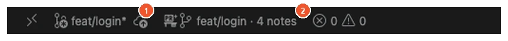

| # | Call it | On screen | What it is |
|---|---|---|---|
| 1 | **VS Code's branch item** | `feat/login*` | VS Code's own git item, not Review Desk's. |
| 2 | **Status bar item** | `feat/login · 4 notes` | Review Desk's. Hover: repository, commit, base. Click: the same menu as ☰. |

## Commands

In the Command Palette (⇧⌘P), after `Review Desk:`. 42 commands.

| Command | Id |
|---|---|
| Change Answer Language… | `reviewDesk.changeLanguage` |
| Change Base… | `reviewDesk.changeBase` |
| Change Compare Side… | `reviewDesk.changeRight` |
| Close Review | `reviewDesk.closeReview` |
| Collapse All | `reviewDesk.tree.collapseAll` |
| Compare… | `reviewDesk.compare` |
| Connect Claude Code Chat | `reviewDesk.connectChat` |
| Diff Since Viewed | `reviewDesk.diffSinceViewed` |
| Disconnect Claude Code Chat | `reviewDesk.disconnectChat` |
| Expand All | `reviewDesk.tree.expandAll` |
| Fetch | `reviewDesk.fetch` |
| Finish Review… | `reviewDesk.finishReview` |
| Hide Viewed Files | `reviewDesk.hideViewed` |
| Mark File as Not Viewed | `reviewDesk.markNotViewed` |
| Mark File as Viewed | `reviewDesk.markViewed` |
| Menu | `reviewDesk.showActions` |
| Next Note | `reviewDesk.nextCard` |
| Open GitHub Pull Request | `reviewDesk.github.open` |
| Open Notes Panel | `reviewDesk.openPanel` |
| Open Pull Request by Its Address… | `reviewDesk.github.openUrl` |
| Open Review File | `reviewDesk.openReviewFile` |
| Post Notes as PR Review | `reviewDesk.github.post` |
| Previous Note | `reviewDesk.prevCard` |
| Re-import GitHub Comments | `reviewDesk.github.importThreads` |
| Refresh Worktrees | `reviewDesk.refreshWorktrees` |
| Report a Problem… | `reviewDesk.reportProblem` |
| Review Desk: Ask About Code | `reviewDesk.askAboutSelection` |
| Review Desk: Explain Code | `reviewDesk.explainSelection` |
| Review Desk: Show Diff | `reviewDesk.showDiff` |
| Review Desk: Show Diff Inline (- +) | `reviewDesk.diffInline` |
| Review Desk: Show Diff Side by Side | `reviewDesk.diffSideBySide` |
| Review Desk: Show File | `reviewDesk.showFile` |
| Review Desk: Summarize Changes | `reviewDesk.summarize` |
| Review Desk: Summarize File | `reviewDesk.summarizeFile` |
| Review Desk: Toggle Diff | `reviewDesk.toggleDiff` |
| Show in Reading Order | `reviewDesk.tree.showReading` |
| Show Log | `reviewDesk.showLog` |
| Show Viewed Files | `reviewDesk.showViewed` |
| Start Review | `reviewDesk.start` |
| Start Review Against Branch… | `reviewDesk.startWithBase` |
| Start Review in Folder… | `reviewDesk.startInFolder` |
| Translate Notes into the Current Language | `reviewDesk.translateNotes` |
